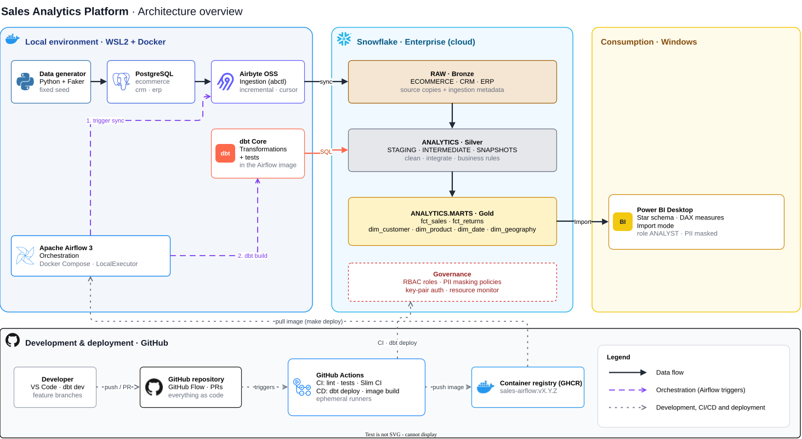

# Sales Analytics Platform

An end-to-end **Modern Data Stack** learning project: from synthetic operational data to a governed, tested and orchestrated analytics platform, built around one business metric, **Net Revenue**.

> **Project status:** Stage 1 of 8 completed: business definition, data modeling and architecture (documentation only). See [Roadmap](#roadmap) and [PROJECT_CONTEXT.md](PROJECT_CONTEXT.md).
>
> Cedar & Co. is a **fictional company**. All data is synthetic, generated with Python and Faker.

## Project overview

The platform consolidates three independent operational systems of a fictional online retailer into a cloud data warehouse, transforms them into a dimensional model with dbt, and exposes trusted metrics in Power BI. It covers the full lifecycle:

| Area | What the project demonstrates |
|---|---|
| Data modeling & architecture | Medallion architecture, Kimball star schema, ERDs, SCD Type 2 |
| Transformation | dbt Core: layered models, incremental `merge` with late-arriving data, snapshots, macros, tests |
| Governance | Role-based access control, dynamic PII masking, data quality and reconciliation tests |
| Data insight | Documented metrics, SQL logic, Power BI semantic model and dashboard |
| DataOps | Git workflow, CI/CD with Slim CI, versioned deployments, reproducible environments |
| Ingestion & orchestration | Airbyte incremental sync, Airflow DAG with sensors, retries and short-circuiting |

## Business context

**Cedar & Co.** sells home and lifestyle goods online in the United States. Its sales data lives in three systems (e-commerce platform, CRM and ERP), each with its own identifiers and conventions. Teams report different revenue numbers, treat cancellations and returns inconsistently, cannot link online accounts to CRM customers reliably, and have no margin visibility.

→ [Business context](docs/business/business-context.md)

## Business objectives

1. One official, documented definition of **Net Revenue**.
2. Sales performance over time, and by product, category, customer segment and region.
3. Visibility of discount and return impact, and of gross margin.
4. Protection of customer personal data.
5. Automated, tested and reproducible reporting.

→ [Analytical requirements](docs/business/analytical-requirements.md) · [Metrics definition](docs/business/metrics-definition.md)

### Primary metric

```
Net Revenue = Gross Revenue − Discounts − Returns
```

- Revenue is recognized at **order date** for paid, shipped or delivered orders.
- Cancelled orders never enter revenue.
- Returns reduce revenue on the **refund date**.
- Order coupons are allocated to items.
- Taxes and shipping are excluded.

Full rules, SQL logic and a worked example are in [metrics-definition.md](docs/business/metrics-definition.md).

## Proposed solution

An **ELT** platform:
1. Synthetic source systems run in PostgreSQL.
2. Airbyte replicates them incrementally into Snowflake.
3. dbt Core transforms them through Bronze, Silver and Gold layers into a star schema.
4. Airflow orchestrates the daily pipeline.
5. GitHub Actions validates and deploys every change.
6. Power BI consumes the Gold layer with masked PII.

## Architecture



| Component | Technology | Role |
|---|---|---|
| Data generation | Python + Faker | Reproducible synthetic data with realistic quality issues |
| Operational sources | PostgreSQL (Docker) | Three independent databases: `ecommerce`, `crm`, `erp` |
| Ingestion | Airbyte OSS | Cursor-based incremental replication into `RAW` |
| Data warehouse | Snowflake (Enterprise) | Storage, compute, access control, masking |
| Transformation | dbt Core | Models, tests, snapshots, documentation, lineage |
| Orchestration | Apache Airflow 3 | Daily pipeline: check → sync → dbt build |
| CI/CD | GitHub Actions + GHCR | Lint, Slim CI, dbt deploy, versioned Airflow image |
| BI | Power BI Desktop | Semantic model, DAX measures, dashboard |

→ [Architecture overview](docs/architecture/architecture-overview.md)

## Data sources

| System | Tables |
|---|---|
| E-commerce | `customers`, `orders`, `order_items`, `payments`, `returns`, `return_items` |
| CRM | `customers`, `customer_contacts` |
| ERP | `products`, `product_categories`, `product_cost_history` |

Volumes: ~1M order items over 24 months. The data contains 12 intentional data quality issues, each with a purpose (identity mismatches, duplicates, SKU formats, time zones, late returns, …).

→ [Source systems and ERDs](docs/architecture/source-systems.md)

## Data modeling

| Layer | Content |
|---|---|
| **Bronze** (`RAW`) | Source copies loaded by Airbyte |
| **Silver** (`ANALYTICS`) | Staging (clean, typed, deduplicated), intermediate (identity resolution, coupon allocation, costs), snapshots |
| **Gold** (`ANALYTICS.MARTS`) | Star schema: `fct_sales` (order item), `fct_returns` (refunded return item), `dim_customer` (SCD2), `dim_product`, `dim_date`, `dim_geography` |

→ [Analytical data model and ERD](docs/architecture/data-model.md)

## Data flow

Sources → Airbyte → `RAW` → dbt staging → intermediate → marts → Power BI, orchestrated by an Airflow DAG that skips the run when there is no new source data.

→ [Data flow](docs/architecture/data-flow.md)

## Data governance

- Four roles with least privilege: `LOADER`, `TRANSFORMER`, `TRANSFORMER_PROD`, `ANALYST`.
- Service users authenticate with key pairs.
- Email and phone are **masked** for analysts by Snowflake masking policies.
- Analysts have no access to Raw or Silver.
- Quality is enforced by layered dbt tests, reconciliation tests and source freshness checks.

→ [Data governance](docs/governance/data-governance.md)

## DataOps

- GitHub Flow with protected `main`, Conventional Commits and SemVer releases.
- Development, CI and production environments.
- Slim CI (`state:modified+` with `--defer`).
- Deployment of a versioned Airflow image through GHCR.

→ [DataOps strategy](docs/dataops/dataops-strategy.md)

## Analytics product

A Power BI dashboard over the Gold star schema (Import mode): Net Revenue and its components, growth, AOV, gross margin, returns and cancellations, filterable by date, product, category, customer segment and region. Delivered in Stage 8.

## Tech stack

| Category | Tools |
|---|---|
| Languages | Python, SQL, Jinja, DAX |
| Data | PostgreSQL, Snowflake |
| Data tools | Airbyte, dbt Core, Apache Airflow, Power BI |
| DevOps | Git, GitHub Actions, Docker, Docker Compose, GHCR |
| Local tooling | WSL2, uv, Make |
| Documentation | Markdown, Mermaid, diagrams.net |

Versions are pinned per component as it is implemented: see [PROJECT_CONTEXT.md](PROJECT_CONTEXT.md#5-tool-versions).

## Getting started

Nothing to run yet: the repository currently contains the design documentation. Prerequisites, setup steps and the clean-clone acceptance test are in [docs/getting-started.md](docs/getting-started.md).

## Project structure

```text
sales-analytics-platform/
├── README.md                  # this file
├── PROJECT_CONTEXT.md         # current status, decisions, versions, next steps
├── docs/
│   ├── README.md              # documentation index
│   ├── getting-started.md     # prerequisites, setup, clean-clone test
│   ├── business/              # business context, requirements, metric definitions
│   ├── architecture/          # architecture, data flow, source and analytical models
│   ├── governance/            # access control, PII protection, data quality
│   ├── dataops/               # branching, environments, CI/CD, deployment
│   ├── modernization/         # legacy ETL migration study
│   ├── decisions/             # Architecture Decision Records (ADRs)
│   └── diagrams/              # editable diagrams (.drawio.svg)
│
│   # planned (added stage by stage)
├── data_generator/            # Stage 2: Python + Faker
├── infrastructure/            # Stage 2–3: PostgreSQL (Docker), Snowflake SQL scripts
├── airbyte/                   # Stage 3: Airbyte configuration as code
├── dbt/                       # Stage 4: dbt project
├── airflow/                   # Stage 6: Dockerfile, Compose, DAGs
├── powerbi/                   # Stage 8: Power BI project (PBIP)
└── .github/workflows/         # Stage 7: CI/CD
```

## Design decisions

Every significant decision is recorded as an ADR with its context, alternatives and consequences. Highlights:

| Decision | ADR |
|---|---|
| Snowflake Enterprise instead of Databricks Free Edition | [0003](docs/decisions/0003-use-snowflake-enterprise-as-data-warehouse.md) |
| Net Revenue recognition rules | [0004](docs/decisions/0004-net-revenue-recognition-rules.md) |
| Cursor-based incremental ingestion instead of CDC | [0006](docs/decisions/0006-cursor-based-incremental-ingestion.md) |
| Separate sales and returns facts | [0013](docs/decisions/0013-separate-sales-and-returns-facts.md) |
| Container image deployment model | [0010](docs/decisions/0010-container-image-deployment-model.md) |

→ [All ADRs](docs/decisions/README.md)

## Roadmap

| Stage | Scope | Status |
|---|---|---|
| 1 | Business definition, requirements, data modeling, architecture | ✅ Done |
| 2 | Data generation (Python + PostgreSQL) | Next |
| 3 | Snowflake setup and Airbyte ingestion | Planned |
| 4 | dbt transformations and modeling | Planned |
| 5 | Governance and security | Planned |
| 6 | Airflow orchestration | Planned |
| 7 | CI/CD with GitHub Actions | Planned |
| 8 | Power BI, final validation, clean-clone test | Planned |

## License

[MIT](LICENSE)
