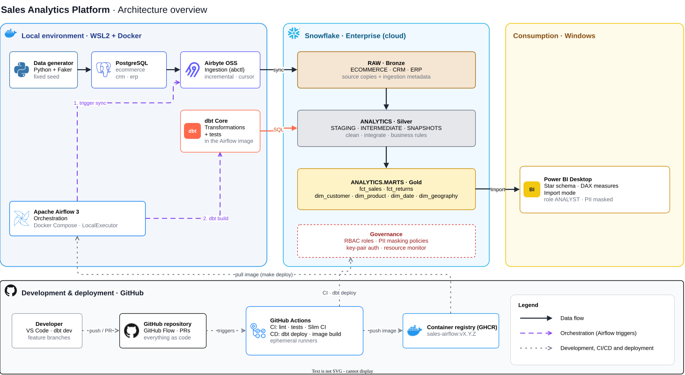

# Architecture Overview

> **Status:** Approved (Stage 1) · **Last updated:** 2026-11-22
>
> Related: [data-flow.md](data-flow.md) · [data-model.md](data-model.md) · [data-governance.md](../governance/data-governance.md) · [dataops-strategy.md](../dataops/dataops-strategy.md) · [ADRs](../decisions/README.md)

## 1. Architecture diagram

*Editable source: [`architecture-overview.drawio.svg`](../diagrams/architecture-overview.drawio.svg). Open it with diagrams.net or the VS Code "Draw.io Integration" extension.*

The diagram separates two flows:

- **Data flow** (solid arrows): data moves from the sources to the dashboard, orchestrated by Airflow.
- **Development and deployment flow** (dashed arrows): code moves from Git through GitHub Actions to the environments.

## 2. Architectural principles

| # | Principle | Consequence |
|---|---|---|
| AP-1 | **ELT, not ETL.** Load raw data first, transform inside the warehouse. | Airbyte does not transform; dbt runs SQL on Snowflake compute |
| AP-2 | **One responsibility per component** | Airbyte ingests, dbt transforms, Airflow orchestrates, GitHub Actions validates and deploys, Power BI presents |
| AP-3 | **Business rules live in one place** (dbt Gold layer) | Power BI measures only aggregate columns |
| AP-4 | **Everything as code, versioned in Git** | dbt project, DAGs, Snowflake configuration (SQL), Docker definitions, Airbyte configuration, documentation |
| AP-5 | **Least privilege** | Each component has its own service user and role with only the permissions it needs |
| AP-6 | **Reproducible from a clean clone** | Pinned versions, Docker, seeded data generation, no local-only files |
| AP-7 | **Simplicity first** | No tool or feature without a documented need ([ADRs](../decisions/README.md)) |
| AP-8 | **Cost awareness (FinOps)** | Small auto-suspended warehouses, incremental processing, skip runs without new data |

## 3. Components

| Component | Technology | Runs on | Responsibility | Does **not** |
|---|---|---|---|---|
| Data generation | Python + Faker | Local (uv environment) | Historical load with a fixed seed; incremental activity (new orders, status changes, returns, segment changes) | Know anything about the warehouse |
| Operational sources | PostgreSQL | Local (Docker Compose) | Simulate three independent systems (three databases) | Contain analytical logic |
| Ingestion | Airbyte OSS | Local (`abctl`, Kubernetes-in-Docker) | Incremental replication (cursor `updated_at`) from PostgreSQL to `RAW`; checkpoints; schema evolution | Transform data or apply business rules |
| Data warehouse | Snowflake (Enterprise trial) | Cloud (AWS) | Storage, compute, access control, masking | — |
| Transformation | dbt Core (dbt-snowflake) | Dev: local · CI/CD: GitHub runner · Prod: Airflow container | Transformations, tests, documentation, lineage, snapshots | Schedule itself or ingest data |
| Orchestration | Apache Airflow 3 | Local (Docker Compose, LocalExecutor) | When and in which order steps run; retries; stop transformations if ingestion fails | Transform data; CI/CD |
| CI/CD | GitHub Actions | Cloud (GitHub-hosted runners) | Lint, test and validate changes; deploy dbt to prod; build and publish the Airflow image | Run the daily pipeline |
| Container registry | GitHub Container Registry (GHCR) | Cloud | Store versioned Airflow images | — |
| BI | Power BI Desktop | Local (Windows) | Semantic model, DAX measures, dashboard | Re-implement business rules |

**Why some components run locally.** The project uses no paid cloud infrastructure besides the Snowflake trial. Services that must be **always on** and **reach the local sources** (PostgreSQL, Airbyte, Airflow) run on the developer machine, which plays the role of a server. Finite tasks (tests, builds) run on GitHub's ephemeral runners, which can reach Snowflake over the internet but **cannot reach the local network**. The cloud equivalent of each local piece is documented in [ADR-0010](../decisions/0010-container-image-deployment-model.md).

## 4. Snowflake layout

### 4.1. Databases and schemas

| Database | Schema | Layer | Written by | Read by |
|---|---|---|---|---|
| `RAW` | `ECOMMERCE`, `CRM`, `ERP` | Bronze | Airbyte (`LOADER`) | dbt (`TRANSFORMER`, `TRANSFORMER_PROD`) |
| `RAW` | `AIRBYTE_INTERNAL` | Airbyte internal state | Airbyte | Airbyte only |
| `ANALYTICS` | `STAGING`, `INTERMEDIATE`, `SNAPSHOTS` | Silver | dbt prod (`TRANSFORMER_PROD`) | dbt (`TRANSFORMER`, for `--defer`) |
| `ANALYTICS` | `MARTS` | Gold | dbt prod (`TRANSFORMER_PROD`) | `ANALYST`, Power BI, dbt (`TRANSFORMER`) |
| `ANALYTICS_DEV` | `DBT_<developer>_*` | Development | Developer (`TRANSFORMER`) | Developer |
| `ANALYTICS_DEV` | `CI_PR_<number>_*` | CI (ephemeral, dropped after the PR) | GitHub Actions (`TRANSFORMER`) | GitHub Actions |

**One ingestion serves all environments.** Dev, CI and prod read the same `RAW` database. That avoids triple ingestion and triple cost, and it is the most common pattern in practice.

### 4.2. Warehouses

| Warehouse | Size | Auto-suspend | Used by | Why separate |
|---|---|---|---|---|
| `INGEST_WH` | X-Small | 60 s | Airbyte | Cost attribution per workload and isolation (a heavy BI query does not slow down dbt). A suspended warehouse costs nothing, so separation is free. |
| `TRANSFORM_WH` | X-Small | 60 s | dbt (all environments) | |
| `REPORTING_WH` | X-Small | 60 s | Power BI, analysts | |

An account-level **resource monitor** caps monthly credit consumption.

### 4.3. Roles and users

| Role | Grants (summary) | Users |
|---|---|---|
| `LOADER` | Owns `RAW` source schemas; uses `INGEST_WH` | `AIRBYTE_SVC` (service user, key pair) |
| `TRANSFORMER` | Reads `RAW` and `ANALYTICS`; writes `ANALYTICS_DEV`; uses `TRANSFORM_WH` | Developer (person), `DBT_CI_SVC` (service user) |
| `TRANSFORMER_PROD` | Reads `RAW`; owns `ANALYTICS`; uses `TRANSFORM_WH` | `DBT_PROD_SVC` (service user: Airflow and dbt deploy) |
| `ANALYST` | `SELECT` on `ANALYTICS.MARTS` only; PII masked; uses `REPORTING_WH` | `ANALYST_DEMO` (person, demonstration), Power BI connection |

Only automation writes to production: the developer role cannot modify `ANALYTICS`. Full grant matrix and masking design: [data-governance.md](../governance/data-governance.md).

## 5. Technology versions

Versions are **pinned when each component is implemented**, after checking compatibility in the official documentation. The authoritative list is kept in [PROJECT_CONTEXT.md](../../PROJECT_CONTEXT.md).

| Technology | Version policy | Constraint already known |
|---|---|---|
| Python | Pinned via `.python-version` (uv) | — |
| PostgreSQL | Pinned Docker image tag | `wal_level` default is enough (no CDC) |
| Airbyte | Pinned `abctl` and connector versions | Snowflake destination ≥ 5.x requires key-pair or PAT authentication |
| dbt Core / dbt-snowflake | Pinned in `uv.lock` | dbt-snowflake **≥ 1.10.6** (Snowflake column-size change, 2026) |
| Apache Airflow | Pinned official image tag (3.x) | Airbyte provider ≥ 6.x uses client ID and secret |
| Power BI Desktop | Latest at Stage 8 | Snowflake connector: key pair supported |

## 6. Deployment topology

| Environment | Where dbt runs | Where Airflow runs | Snowflake target |
|---|---|---|---|
| Development | Developer terminal (WSL) | Local (optional, for DAG development) | `ANALYTICS_DEV` |
| CI | GitHub Actions runner | — (DAG import tests only) | `ANALYTICS_DEV.CI_PR_*` |
| Production | Airflow container (scheduled) + GitHub Actions (deploy of changed models) | Local Docker Compose, running the **released image** from GHCR | `ANALYTICS` |

Release flow: [dataops-strategy.md](../dataops/dataops-strategy.md).

## 7. Technical risks

| # | Risk | Impact | Mitigation | Status |
|---|---|---|---|---|
| R-01 | Snowflake trial expires (30 days or credits used) | Warehouse unavailable | Account created only at Stage 3; all configuration in versioned SQL, so a new account can be rebuilt in minutes; option to convert to on-demand with a low resource monitor cap | Accepted |
| R-02 | Airbyte local footprint (~4 CPUs, ~8 GB RAM) on WSL2 | Slow machine; failure on the second computer | Raise the WSL memory limit (`.wslconfig`); do not run all services at once when not needed; minimum requirements documented | Open (validate at Stage 3) |
| R-03 | Network between containers: Airbyte runs in a Kubernetes-in-Docker cluster and must reach PostgreSQL; Airflow must reach the Airbyte API | Connection failures | Use `host.docker.internal` / host gateway; document and test on both machines | Open (validate at Stages 3 and 6) |
| R-04 | Power BI Service requires a work or school account | No cloud publishing; RLS testable only in Desktop | Power BI Desktop with PBIP format (versionable) | Accepted |
| R-05 | "Production" runs on a developer machine | Not a real always-on server | Same artifacts as a cloud deployment (versioned image); cloud mapping documented ([ADR-0010](../decisions/0010-container-image-deployment-model.md)) | Accepted |
| R-06 | Cursor-based ingestion cannot detect hard deletes | Deleted rows persist in `RAW` | Sources never hard-delete (assumption A-1) | Accepted |
| R-07 | Snowflake authentication hardening (password-only logins being phased out) | Tools fail to connect | Key-pair authentication for all service users from day one | Mitigated by design |
| R-08 | Snapshot history starts only at first run | Historical segment attribution approximated | Documented limitation ([data-model.md](data-model.md#52-customer-history-scd-type-2)) | Accepted |
| R-09 | Mixing up corporate and personal identities on the same machine | Corporate data or credentials in a personal project | Repository-local Git identity; personal email for Snowflake; no corporate tooling | Mitigated |

## 8. Alternatives considered

Summary. Each decision has an ADR with context and trade-offs.

| Decision | Chosen | Main alternatives | ADR |
|---|---|---|---|
| Warehouse | Snowflake Enterprise (trial) | Databricks Free Edition | [0003](../decisions/0003-use-snowflake-enterprise-as-data-warehouse.md) |
| Ingestion method | Cursor-based incremental | CDC (logical replication) | [0006](../decisions/0006-cursor-based-incremental-ingestion.md) |
| Warehouse configuration | Versioned SQL scripts | Terraform (planned future improvement) | [0007](../decisions/0007-snowflake-configuration-as-versioned-sql.md) |
| Local Airflow | Docker Compose (LocalExecutor) | Astro CLI | [0008](../decisions/0008-airflow-with-docker-compose.md) |
| dbt execution in Airflow | BashOperator, isolated virtualenv | Astronomer Cosmos, DockerOperator | [0009](../decisions/0009-run-dbt-with-bashoperator-in-isolated-venv.md) |
| Deployment | Versioned container image (GHCR) | dbt Cloud, managed Airflow | [0010](../decisions/0010-container-image-deployment-model.md) |
