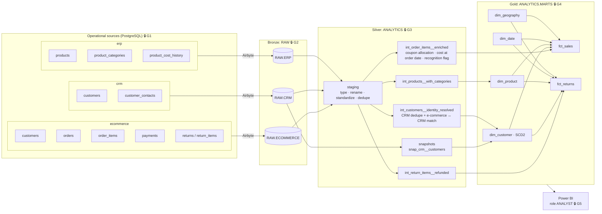
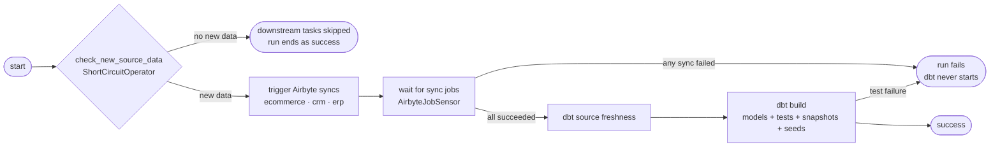

# Data Flow

> **Status:** Approved (Stage 1) · **Last updated:** 2026-11-22
>
> Related: [architecture-overview.md](architecture-overview.md) · [source-systems.md](source-systems.md) · [data-model.md](data-model.md) · [data-governance.md](../governance/data-governance.md)

## 1. Logical data flow and governance points

This is **Diagram 2**: how each source entity moves through the layers until it reaches the dashboard. 🔒 marks the points where governance controls apply (G1–G6, detailed in [data-governance.md](../governance/data-governance.md)).

`dim_date` is generated by dbt and `dim_geography` comes from a seed (reference CSV). Neither has an operational source.

## 2. What happens in each layer

| Layer | Input | Transformations | Output guarantees |
|---|---|---|---|
| **Sources** | — | Generated by Python/Faker with a fixed seed | Realistic issues Q1–Q12 ([source-systems.md](source-systems.md#6-planned-data-quality-issues)) |
| **Bronze** | Source tables | **None**: Airbyte copies rows and adds metadata (`_airbyte_extracted_at`, `_airbyte_raw_id`, …) | Faithful copy of the source; PII in clear text; restricted access |
| **Staging** | Bronze | Data types, `snake_case` names, UTC → America/New_York, email and phone normalization, SKU canonicalization, state mapping, payment webhook deduplication | One clean model per source table; primary keys unique and not null |
| **Snapshots** | Bronze `crm.customers` | Change capture (SCD2) | Customer segment history |
| **Intermediate** | Staging + snapshots + seeds | CRM deduplication, identity resolution, category flattening, coupon allocation, cost lookup, revenue recognition flag | Integrated entities, business rules applied once |
| **Gold** | Intermediate | Dimensional modeling: surrogate keys, unknown members, point-in-time joins | Star schema; every metric derivable by simple aggregation |
| **BI** | Gold | DAX measures (aggregation only), relationships, filters | Analysts see masked PII; no access to other layers |

## 3. Orchestration flow (daily pipeline)

The main Airflow DAG (`sales_pipeline`, built in Stage 6):

| Step | Purpose | Failure behavior |
|---|---|---|
| `check_new_source_data` | Compares `MAX(updated_at)` in the PostgreSQL sources with the same value in `RAW`. Skips the run when nothing changed (saves warehouse credits). | Skip, not failure |
| Airbyte sync + sensor | Incremental replication; the sensor waits for the asynchronous Airbyte job | Retries; then failure |
| `dbt source freshness` | Confirms `RAW` was updated recently | Failure stops the pipeline |
| `dbt build` | Runs seeds, snapshots, models and tests in dependency order. A failing test stops the models that depend on it. | Failure |

**Source activity is not part of this DAG.** The data generator simulates external systems that the data platform does not control. It runs manually or through a separate DAG (`simulate_source_activity`).

## 4. Lifecycle of one order through the platform

An example of how updates and late-arriving data flow through the layers. Order `ORD-2026-0001234`, two items:

| Day | Source event | Bronze (`RAW`) | Gold |
|---|---|---|---|
| D0 | Order placed, `pending_payment` | 1 order + 2 items loaded | 2 rows in `fct_sales`, `is_recognized_sale = false`: not in revenue |
| D0 | Payment captured → `paid` | `orders` row updated (new `updated_at`, new `_airbyte_extracted_at`) | The 2 rows are **merged**: `is_recognized_sale = true`; revenue appears on D0 |
| D2 | Shipped → `shipped` | `orders` updated | Status updated; revenue unchanged |
| D5 | Delivered → `delivered` | `orders` updated | Status updated |
| D20 | Return requested for 1 unit | New `returns` and `return_items` rows | Nothing yet: return not refunded |
| D27 | Return refunded | `returns` updated (`refunded`, `refunded_at`) | 1 row in `fct_returns` on **D27**: Net Revenue of D27 decreases; D0 unchanged |

Why this works:
- Each change creates a **new ingestion timestamp**, so the incremental models pick it up.
- The `fct_sales` change detection looks at **orders and order items**, so a status change on the order alone is enough.
- `merge` updates existing rows instead of duplicating them.

## 5. Data latency

| Stage | Expected latency |
|---|---|
| Source change → `RAW` | Next pipeline run (daily schedule; manual runs possible) |
| `RAW` → `MARTS` | Same pipeline run (minutes at this volume) |
| `MARTS` → Power BI | Dataset refresh (Import mode), manual or scheduled in Desktop |
