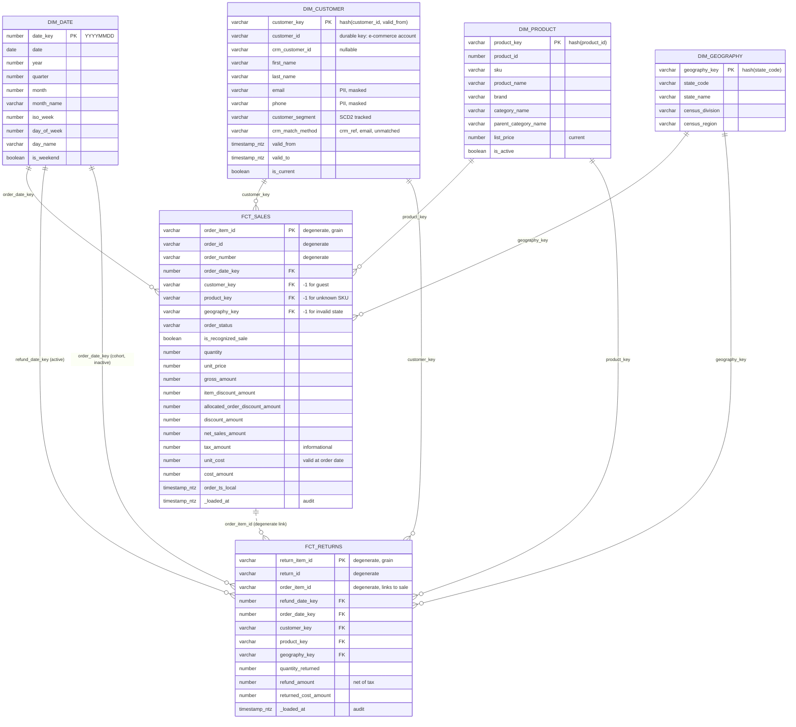
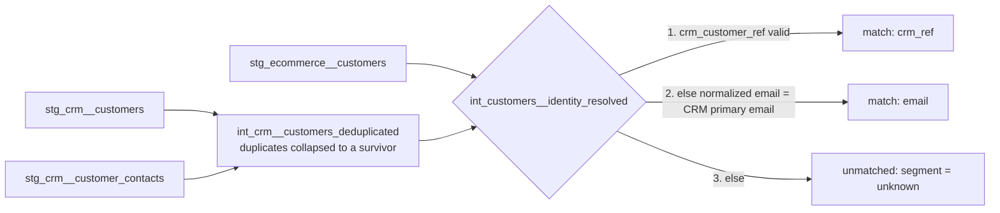

# Analytical Data Model

> **Status:** Approved (Stage 1) · **Last updated:** 2026-11-22
>
> Related: [source-systems.md](source-systems.md) · [metrics-definition.md](../business/metrics-definition.md) · [data-flow.md](data-flow.md)
>
> Model names and columns are the design target for Stage 4. Implementation details marked *(Stage 4)* are confirmed during implementation.

## 1. Modeling strategy

### 1.1. Medallion architecture vs dimensional modeling

These are **complementary concepts that answer different questions**:

| | Medallion architecture | Dimensional modeling |
|---|---|---|
| Question it answers | *How refined is this data, and who is responsible for it?* | *What shape should data have to be analyzed?* |
| Organizes | The **pipeline**, in layers of increasing quality | The **tables**, as facts and dimensions |
| Applies to | The whole platform | Mainly the Gold (consumption) layer |

The Gold layer of the Medallion architecture **is** a dimensional model.

| Layer | Snowflake location | Content | Modeling style |
|---|---|---|---|
| **Bronze / Raw** | `RAW.<system>` | Source tables as loaded by Airbyte, plus ingestion metadata | Source structure (operational, normalized) |
| **Silver: staging** | `ANALYTICS.STAGING` | One model per source table: typed, renamed, standardized, deduplicated | Source structure, cleaned |
| **Silver: intermediate** | `ANALYTICS.INTERMEDIATE` | Integrated entities and business rules (identity resolution, allocations, costs) | Purpose-built |
| **Silver: snapshots** | `ANALYTICS.SNAPSHOTS` | Change history captured by dbt snapshots | Type 2 history |
| **Gold / Marts** | `ANALYTICS.MARTS` | Facts and dimensions consumed by Power BI | **Dimensional (star schema)** |

### 1.2. Why a dimensional model (Kimball star schema)

| Alternative | Why not chosen as the consumption model |
|---|---|
| **Star schema** ✅ | Natural fit for the business questions (measures sliced by product, customer, date, region). Native model for Power BI, whose VertiPaq engine and DAX are designed for star schemas. Easy to explain to business users. |
| One Big Table (OBT) | Simple to query, but mixes grains: sales and returns happen at different dates and grains. Dimension attributes are repeated on every row, and Power BI works worse with wide flat tables. |
| Third normal form (3NF) | Good for operational systems. For analysis it requires many joins and does not express business processes. |
| Data Vault | Built for many sources, auditability and frequent source changes. Overkill for three sources and one business process. |

## 2. Bus matrix

| Fact \ Dimension | `dim_date` | `dim_customer` | `dim_product` | `dim_geography` |
|---|---|---|---|---|
| **`fct_sales`** (order item) | ✅ order date | ✅ version valid at order time | ✅ | ✅ shipping state |
| **`fct_returns`** (refunded return item) | ✅ refund date (primary) + order date (cohort) | ✅ same as original sale | ✅ same as original sale | ✅ same as original sale |

Every dimension is **conformed**: shared by both facts with the same keys and meaning. That is what makes Net Revenue (sales minus returns) consistent across any slice.

## 3. Gold layer ERD



## 4. Facts

### 4.1. `fct_sales`

| Property | Value |
|---|---|
| **Grain** | One row per **order item**, for **all order statuses** |
| Primary key | `order_item_id` |
| Business process | Selling |
| Type | Transaction fact, with attributes updated over time (status) |
| Materialization | **Incremental**, strategy `merge`, `unique_key = order_item_id` |

**Why all statuses with a flag, rather than recognized sales only?** One fact supports Gross Revenue (`is_recognized_sale`), Cancelled Order Value (`order_status = 'cancelled'`) and future funnel analyses. The recognition rule lives in **one column**, computed by dbt, instead of being repeated in every query or measure.

**Why is product cost on the fact and not on `dim_product`?** Cost is a **measure that varies over time** and must be frozen at the moment of the sale. On a Type 1 dimension, all history would use today's cost. Making the product dimension Type 2 for cost would be more complex and less precise.

**Why separate facts for sales and returns?** A return is a **different business event**, with its own date, quantity and status, and possibly several returns per order item. Storing returns as columns on `fct_sales` would lose the refund date and the multiplicity, and would force restating old sales rows.

### 4.2. `fct_returns`

| Property | Value |
|---|---|
| **Grain** | One row per **return item** whose return is **refunded** |
| Primary key | `return_item_id` |
| Business process | Returns / refunds |
| Materialization | **Incremental**, `merge`, `unique_key = return_item_id` |

Returns that are not yet refunded (or rejected) stay in the Silver layer. They do not affect any metric (see [metrics-definition.md](../business/metrics-definition.md#34-returns)). Customer, product and geography keys are **copied from the original sale**, so a return is always attributed to the same slice as the sale it reverses.

## 5. Dimensions

| Dimension | Grain | Source | SCD type | Unknown member |
|---|---|---|---|---|
| `dim_customer` | One row per **version** of an e-commerce customer account | `ecommerce.customers` + CRM (via identity resolution) + CRM snapshot | **Type 2** on `customer_segment`; Type 1 on other attributes | `-1`: guest checkout |
| `dim_product` | One row per ERP product | `erp.products` + `erp.product_categories` | Type 1 | `-1`: SKU not found in the ERP |
| `dim_date` | One row per calendar day | Generated by dbt (no source) | Static | — |
| `dim_geography` | One row per US state (+ DC) | dbt **seed** `us_states.csv` (reference data) | Static | `-1`: missing or invalid state |

**Unknown members** keep every fact row in the model. A guest order or an orphan SKU still counts in Net Revenue, and it appears as "Unknown" instead of disappearing because of an inner join.

### 5.1. Customer integration (identity resolution)

`dim_customer` is anchored on the **e-commerce account**, because that is the entity that buys. CRM-only customers (leads that never bought online) have no sales and are **not** in the Gold layer.



| Step | Rule |
|---|---|
| 1. CRM deduplication | Records sharing the same normalized primary email are the same person. **Survivor** = the active, non-deleted record with the most recent `updated_at`. Duplicate IDs are mapped to the survivor. |
| 2. Match by reference | If `crm_customer_ref` exists and points to a CRM record (or to a duplicate, mapped to its survivor), use it |
| 3. Match by email | Otherwise, match `lower(trim(email))` against CRM primary emails |
| 4. Unmatched | No CRM link: `customer_segment = 'unknown'`, `crm_match_method = 'unmatched'` |

The match is **Type 1**: if a customer is matched later (reference filled in), the current mapping applies.

### 5.2. Customer history (SCD Type 2)

**What is tracked:** the CRM loyalty `segment`. It answers BQ-12: revenue by segment **as it was at purchase time**.

**How history is captured:** a **dbt snapshot on the CRM source table** (`snap_crm__customers`), `timestamp` strategy on `updated_at`. Each run compares the source with the snapshot. When a record changed, the snapshot closes the old version (`dbt_valid_to`) and inserts a new one.

**Why snapshot the source and not a derived model?** dbt recommends snapshotting sources. A snapshot of a transformed model would record changes caused by **our own logic fixes** as if they were business history.

**How a fact finds the right version (point-in-time join):**

```sql
-- planned logic (Stage 4)
left join dim_customer c
    on  s.customer_id = c.customer_id
    and s.order_ts_local >= c.valid_from
    and s.order_ts_local <  c.valid_to       -- current version: valid_to = '9999-12-31'
```

**Known limitations (documented trade-offs):**

| Limitation | Handling |
|---|---|
| A snapshot only sees changes **from its first run onward**. The 24 months of generated history have no earlier segment history. | The first version of each customer gets `valid_from = '1900-01-01'`. Orders before the first snapshot are attributed to the **earliest known segment**. |
| Changes between two snapshot runs are not captured, only the state at each run | Acceptable for a daily process. Segment changes are not intra-day events. |
| If a customer is matched to the CRM **after** older facts were loaded, those facts keep the key resolved at load time | Periodic full refresh of the facts (cheap at this volume). Detected by a `relationships` test. |

### 5.3. Surrogate keys

Surrogate keys are **deterministic hashes** (`dbt_utils.generate_surrogate_key`), not sequences:

| Advantage | Trade-off |
|---|---|
| The same input always produces the same key, so rebuilds and reprocessing are **idempotent** | Text keys are larger than integers. Negligible at 1M rows. |
| No dependency on load order; facts and dimensions can be built in parallel | Hash collisions are theoretically possible (MD5), practically irrelevant here |

`dim_date` uses a readable integer key (`20260115`), the usual convention for calendar dimensions.

## 6. Incremental strategy (facts)

This is the core technical challenge of the transformation layer. Details are validated in Stage 4.

| Topic | Design |
|---|---|
| Strategy | `merge` on the fact's `unique_key`: new rows are inserted, changed rows are updated |
| Change detection | A row is reprocessed when **any** of its sources changed. For `fct_sales`: the order item **or its order** (a cancellation changes `orders`, not `order_items`). For `fct_returns`: the return item **or its return**. |
| Watermark column | **Ingestion timestamp** (`_airbyte_extracted_at`), not the business `updated_at`. It reflects when data *arrived in the warehouse*, so records that arrive late are still picked up. Validated in Stage 3 ([ADR-0016](../decisions/0016-airbyte-ingestion-configuration.md)): rows re-read by Airbyte on cursor ties also get a new value and are merged again, with the same result. |
| Lookback window | Reprocess everything ingested in the last **3 days** before the current watermark. Safety margin for partial loads and retries. |
| Idempotency | Running the same model twice gives the same result: `merge` updates instead of duplicating, and keys are deterministic |
| Late-arriving data | A status change or return weeks after the order arrives with a new ingestion timestamp and is merged into the existing row |
| Full refresh | `dbt build --full-refresh -s fct_sales` rebuilds from scratch. Used after logic changes that affect history, and periodically (see 5.2). Preceded by a zero-copy clone as a rollback point. |
| Schema changes | `on_schema_change` setting chosen in Stage 4 (`append_new_columns` vs `fail`) |
| `append` strategy | Not used for facts: it cannot update existing rows (status changes). Discussed in Stage 4 for comparison. |

## 7. Model inventory

| Layer | Model | Materialization *(Stage 4)* | Purpose |
|---|---|---|---|
| Staging | `stg_ecommerce__customers`, `__orders`, `__order_items`, `__payments`, `__returns`, `__return_items` | view | Typing, renaming, UTC → local time, normalization, payment webhook deduplication |
| Staging | `stg_crm__customers`, `stg_crm__customer_contacts` | view | Local time handling, phone and email normalization |
| Staging | `stg_erp__products`, `stg_erp__product_categories`, `stg_erp__product_cost_history` | view | Typing, SKU canonicalization |
| Snapshot | `snap_crm__customers` | snapshot | Segment history |
| Seed | `us_states` | seed (table) | State → division → region reference |
| Intermediate | `int_crm__customers_deduplicated` | view / table | CRM survivorship |
| Intermediate | `int_customers__identity_resolved` | table | E-commerce ↔ CRM mapping |
| Intermediate | `int_products__with_categories` | view | Flattened category hierarchy |
| Intermediate | `int_order_items__enriched` | view / ephemeral | Coupon allocation, SKU match, cost at order date, recognition flag |
| Intermediate | `int_return_items__refunded` | view | Refunded returns with keys of the original sale |
| Marts | `dim_date`, `dim_geography`, `dim_product`, `dim_customer` | table | Dimensions |
| Marts | `fct_sales`, `fct_returns` | **incremental** | Facts |

## 8. Out of the Gold layer (by decision)

| Data | Where it stays | Reason |
|---|---|---|
| Payments | Silver (staging) | Revenue is based on order items. Payments feed the reconciliation test DQ-05. |
| Non-refunded returns | Silver | They do not affect metrics. Can become a return-pipeline analysis later. |
| CRM-only customers | Silver | No sales |
| City and postal code | Silver | Not needed for analysis; quasi-identifiers (see [data-governance.md](../governance/data-governance.md)) |
| Shipping fees | Silver | Excluded from revenue metrics |
| Aggregated marts | — | Not needed initially: Power BI Import over the star schema meets the requirements |
