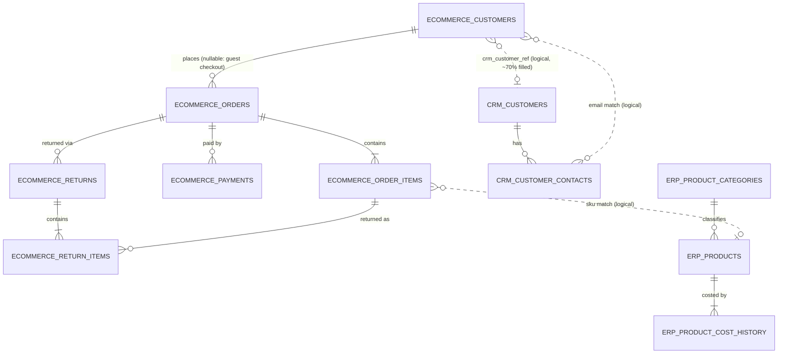
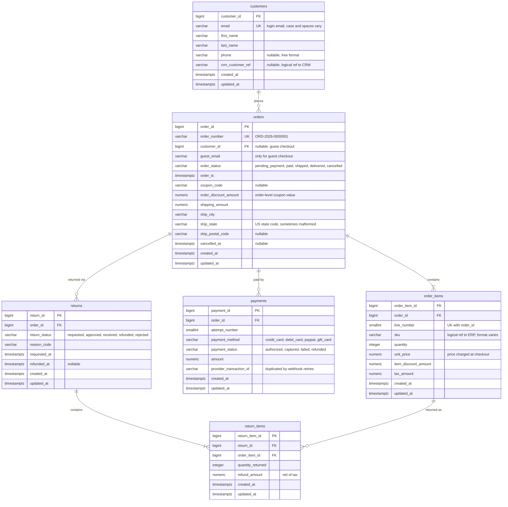
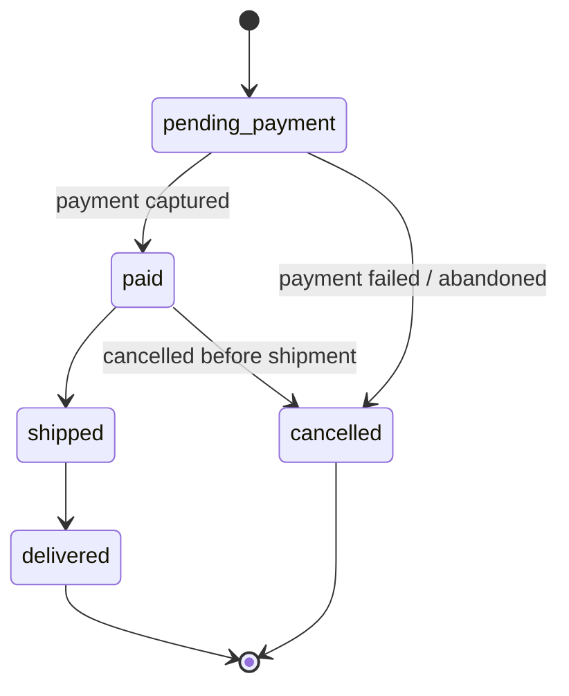
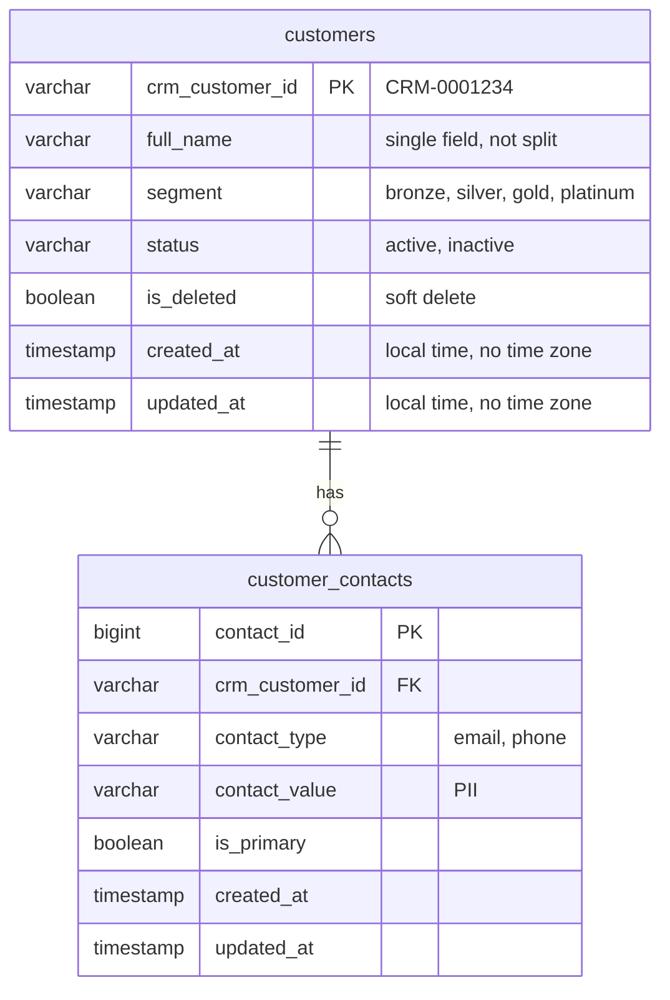
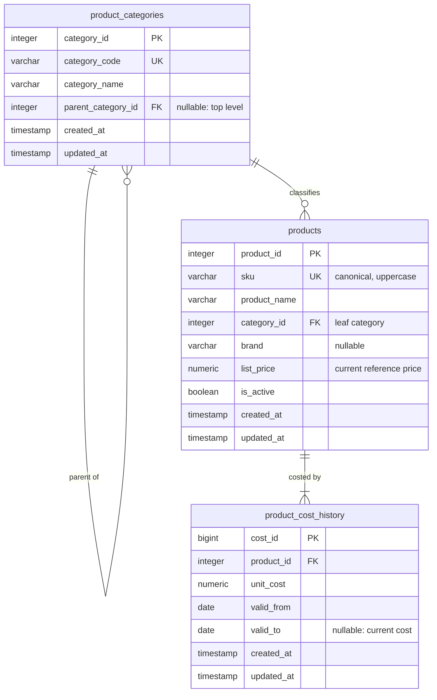

# Source Systems (Operational Data Model)

> **Status:** Approved (Stage 1) · **Last updated:** 2026-11-22
>
> Related: [business-context.md](../business/business-context.md) · [data-model.md](data-model.md) · [data-flow.md](data-flow.md)
>
> This model guides the data generator (Stage 2). Column types are PostgreSQL types.

## 1. Overview

Cedar & Co. runs three independent operational systems. They are simulated as **three separate databases in one PostgreSQL container**.

| System | PostgreSQL database | Schema | ID style | Timestamp style |
|---|---|---|---|---|
| E-commerce platform | `ecommerce` | `public` | `bigint` identity | `timestamptz` (UTC) |
| CRM | `crm` | `public` | Text (`CRM-0001234`) | `timestamp` without time zone (local time, America/New_York) |
| ERP | `erp` | `public` | `integer` identity | `timestamp` without time zone (local time, America/New_York) |

**Why separate databases and not schemas?** A PostgreSQL query cannot join tables across databases. That reproduces the real constraint: the systems are independent, and integration can only happen downstream, in the warehouse. Each database also becomes an independent source in Airbyte. One container is enough. Three containers would add resource usage without adding learning value. See [ADR-0005](../decisions/0005-simulate-sources-as-postgres-databases.md).

**Conventions shared by all tables:**

| Convention | Purpose |
|---|---|
| Every table has `created_at` and `updated_at` | `updated_at` is the **cursor** for incremental ingestion |
| `updated_at` is maintained by a database **trigger** on every `UPDATE` | The cursor cannot be forgotten by application code |
| **No hard deletes**: status changes or `is_deleted` flags only | Cursor-based ingestion cannot detect deleted rows (assumption A-1) |
| Foreign keys are enforced **inside** each database | Realistic referential integrity within one system |
| Cross-system references are **plain values, never FKs** | Systems do not know each other |

## 2. Cross-system view

How the three systems relate. Solid lines are enforced foreign keys inside a database. Dotted lines are **logical matches** that must be resolved in the warehouse.

## 3. E-commerce (`ecommerce`)

### Table notes

| Table | Grain | Lifecycle (what changes after insert) | Notes |
|---|---|---|---|
| `customers` | One online account | `phone` updated, `crm_customer_ref` filled in later | `email` unique (case-insensitive) |
| `orders` | One order | `order_status` moves forward; `cancelled_at` set on cancellation | Shipping address is stored on the order (address at time of purchase). `customer_id` is null for guest checkout (~5%), and `guest_email` is filled instead |
| `order_items` | One order line | Rarely updated | `(order_id, line_number)` unique. `numeric(12,2)` for amounts |
| `payments` | One payment attempt | `payment_status` changes (`authorized` → `captured` → `refunded`) | Failed attempts followed by a successful retry are normal (1:N per order) |
| `returns` | One return request | `return_status` moves forward; `refunded_at` set at refund | Only `delivered` orders can have returns |
| `return_items` | One returned order line | Inserted with the return | Partial quantities allowed; total returned ≤ quantity sold |

**Order status lifecycle:**

**Return status lifecycle:** `requested` → `approved` → `received` → `refunded`, or `requested` → `rejected`.

## 4. CRM (`crm`)

| Table | Grain | Lifecycle | Notes |
|---|---|---|---|
| `customers` | One CRM customer record | **`segment` changes over time** (drives SCD2); `status` changes; soft delete | ~2% of real people have two records (duplicates) |
| `customer_contacts` | One contact point | New emails or phones added; `is_primary` moves | A customer can have several emails and phones; one primary per type |

The CRM also holds customers who never bought online (leads, phone customers). They are not part of the sales analysis. See [data-model.md](data-model.md).

## 5. ERP (`erp`)

| Table | Grain | Lifecycle | Notes |
|---|---|---|---|
| `product_categories` | One category | Rare renames | Two-level hierarchy: ~8 parent categories, ~32 leaf categories |
| `products` | One product | `list_price` and `is_active` change | Products are linked to leaf categories only |
| `product_cost_history` | One standard-cost validity period | A cost revision closes the current row (`valid_to`) and inserts a new one | Periods per product do not overlap; exactly one open row per product |

## 6. Planned data quality issues

Every issue has a technical or business purpose. Each one maps to a technique that the transformation layer must demonstrate.

| ID | Issue | Where | Approx. rate | Purpose / technique demonstrated |
|---|---|---|---|---|
| Q1 | Email case and whitespace differ between systems (`John.Doe@Mail.com ` vs `john.doe@mail.com`) | `ecommerce.customers`, `crm.customer_contacts` | ~15% | Normalization before matching (identity resolution) |
| Q2 | `crm_customer_ref` missing | `ecommerce.customers` | ~30% | Fallback matching rule by normalized email |
| Q3 | Same person registered twice in the CRM | `crm.customers` | ~2% | Deduplication and survivorship rule |
| Q4 | Phone numbers in many formats (`(212) 555-0100`, `212.555.0100`, `+1 212 555 0100`) | both | ~40% | Standardization macro (E.164) |
| Q5 | SKU format variations (`ck-1001`, ` CK-1001`, `CK1001`) | `order_items.sku` | ~3% | Standardization before join |
| Q6 | SKU not found in the ERP | `order_items.sku` | ~0.1% | `relationships` test with `warn` severity + unknown member in the dimension |
| Q7 | Duplicate payment rows from webhook retries (same `provider_transaction_id`) | `payments` | ~0.5% | Deduplication in staging |
| Q8 | Time zones differ: UTC in e-commerce, local time without zone in CRM and ERP | all | 100% | Timestamp standardization |
| Q9 | Status changes, payment updates and returns arriving weeks after the order | `orders`, `payments`, `returns` | continuous | Incremental `merge`, lookback window, late-arriving data |
| Q10 | Missing values in optional fields (`phone`, `ship_postal_code`, `brand`) | several | 2–10% | Selective `not_null` tests and explicit defaults |
| Q11 | Soft-deleted CRM records | `crm.customers` | ~1% | Filtering vs preserving history; effect on SCD2 |
| Q12 | Shipping state as full name or lowercase (`california`, `Ca`) or invalid | `orders.ship_state` | ~1% | Mapping to reference data (seed) + unknown member |

**Not a data quality issue:** `order_items.unit_price` differing from the current `products.list_price`. Prices change over time, and the fact table must use the transactional price. This difference is documented so that it is not "fixed" by mistake.

## 7. Volumes

The history covers **24 months**, ending at a configurable anchor date, so that runs are reproducible with a fixed seed.

| Table | Approx. rows (initial load) | Incremental run (~1,000 new order items) |
|---|---|---|
| `ecommerce.order_items` | **1,000,000** | +1,000 |
| `ecommerce.orders` | 400,000 | +400 inserts, plus status updates on recent orders |
| `ecommerce.payments` | 430,000 | +430 inserts, plus status updates |
| `ecommerce.customers` | 50,000 | +~50 new accounts, plus profile updates |
| `ecommerce.returns` / `return_items` | 24,000 / 35,000 | +~25 / +~35, plus status updates |
| `crm.customers` | 48,000 | +~50, plus **segment changes** |
| `crm.customer_contacts` | 85,000 | +~80 |
| `erp.products` | 2,000 | Occasional price and active-flag changes |
| `erp.product_categories` | 40 | Static |
| `erp.product_cost_history` | 5,000 | Occasional cost revisions |

## 8. PII inventory

| Data | Location | Classification |
|---|---|---|
| Email | `ecommerce.customers.email`, `ecommerce.orders.guest_email`, `crm.customer_contacts.contact_value` (type `email`) | **PII** |
| Phone | `ecommerce.customers.phone`, `crm.customer_contacts.contact_value` (type `phone`) | **PII** |
| Names | `ecommerce.customers.first_name/last_name`, `crm.customers.full_name` | Personal data: not masked in this project by decision, documented in [data-governance.md](../governance/data-governance.md) |
| Shipping city / postal code | `ecommerce.orders` | Quasi-identifier: kept out of the Gold layer, which uses state only |

Controls for each layer are described in [data-governance.md](../governance/data-governance.md).
