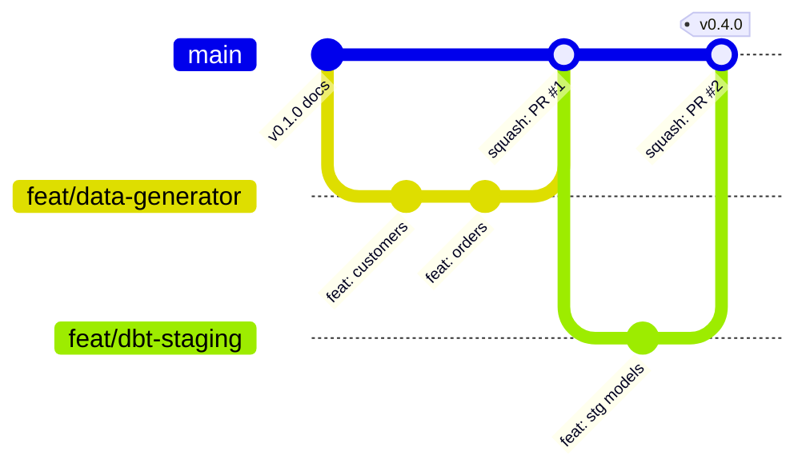
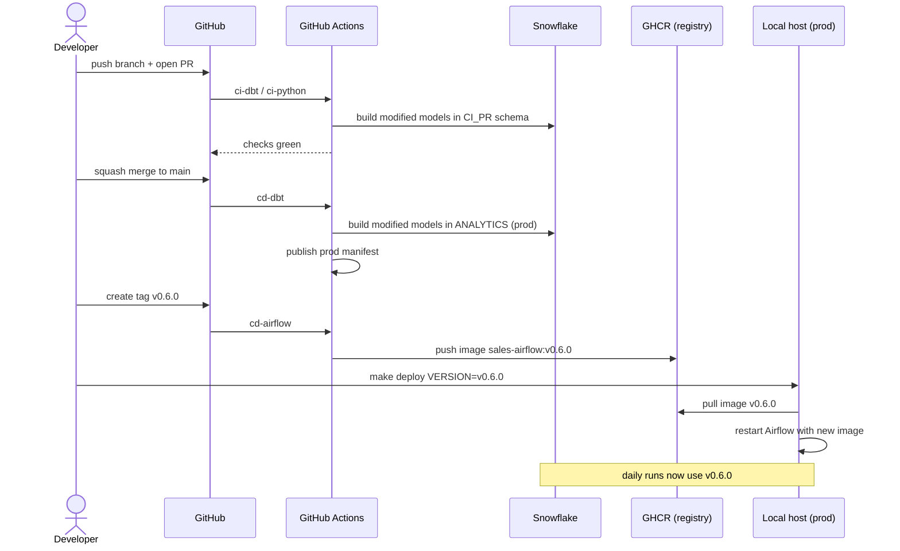

# DataOps Strategy

> **Status:** Approved design (Stage 1). CI/CD implemented in Stage 7 · **Last updated:** 2026-11-22
>
> Related: [architecture-overview.md](../architecture/architecture-overview.md) · [data-governance.md](../governance/data-governance.md) · [getting-started.md](../getting-started.md) · [ADR-0010](../decisions/0010-container-image-deployment-model.md) · [ADR-0011](../decisions/0011-github-flow-and-semantic-versioning.md)

## 1. Scope of responsibilities

| Concern | Tool | Not responsible for |
|---|---|---|
| Version control | Git + GitHub | — |
| Validation of changes (CI) | GitHub Actions | Running the daily pipeline |
| Publication of versions (CD) | GitHub Actions | Scheduling |
| Pipeline execution and scheduling | Apache Airflow | Testing code changes |

GitHub Actions answers *"is this code correct, and is this version published?"*. Airflow answers *"did today's data run correctly?"*.

## 2. Branching strategy: GitHub Flow

| Rule | Detail |
|---|---|
| `main` is always deployable | Protected: no direct pushes after the first commit; PR with green CI required |
| Short-lived branches | One branch per logical change, merged within days |
| Branch naming | `<type>/<short-description>`: `feat/dbt-staging`, `fix/fct-sales-lookback`, `docs/governance`, `ci/dbt-slim-ci`, `chore/pin-versions` |
| Merge method | **Squash merge**: one commit per PR on `main`, titled with the PR title |
| Exception | The first commit (Stage 1 documentation) goes directly to `main` |

**Why not GitFlow?** GitFlow (`develop`, `release/*`, `hotfix/*`) supports parallel release lines and large teams. For one developer with continuous delivery it only adds merges and long-lived branches.

## 3. Commit convention: Conventional Commits

Format: `<type>(<scope>): <description>`

| Type | Use | Example |
|---|---|---|
| `feat` | New functionality | `feat(dbt): add fct_sales incremental model` |
| `fix` | Bug fix | `fix(dbt): include order updates in fct_sales change detection` |
| `docs` | Documentation only | `docs: define net revenue rules` |
| `test` | Tests only | `test(dbt): add coupon allocation unit test` |
| `refactor` | Code change without behavior change | `refactor(airflow): extract snowflake check to helper` |
| `ci` | CI/CD workflows | `ci: add dbt slim ci workflow` |
| `chore` | Maintenance, dependencies | `chore: pin dbt-snowflake 1.10.x` |
| `build` | Docker images, build system | `build(airflow): add dbt virtualenv to image` |

Scopes: `data-generator`, `postgres`, `airbyte`, `snowflake`, `dbt`, `airflow`, `powerbi`, `ci`.

Commits are written in English, in the imperative mood, without a trailing period.

## 4. Versioning

**Semantic Versioning** (`MAJOR.MINOR.PATCH`) with Git tags and GitHub Releases.

| Version | Milestone |
|---|---|
| `v0.1.0` | Stage 1: documentation and planning |
| `v0.2.0` | Stage 2: data generation (PostgreSQL) |
| `v0.3.0` | Stage 3: Snowflake + Airbyte ingestion |
| `v0.4.0` | Stage 4: dbt transformations |
| `v0.5.0` | Stage 5: governance and security |
| `v0.6.0` | Stage 6: Airflow orchestration |
| `v0.7.0` | Stage 7: CI/CD |
| `v1.0.0` | Stage 8: dashboard, final validation, clean-clone test passed |

After `v1.0.0`: `PATCH` for fixes, `MINOR` for backward-compatible features, `MAJOR` for breaking changes to Gold models (columns removed or renamed, which affects Power BI).

The Airflow image is tagged with the same version (`ghcr.io/<owner>/sales-airflow:v0.6.0`), so the running code can always be traced to a release.

## 5. Environments

| | Development | CI | Production |
|---|---|---|---|
| Purpose | Build and test changes | Validate pull requests automatically | Serve the business |
| Runs on | Developer terminal (WSL) | GitHub-hosted runner | Airflow (local Docker Compose, released image) + GitHub Actions deploy |
| dbt target | `dev` | `ci` | `prod` |
| Snowflake database | `ANALYTICS_DEV` | `ANALYTICS_DEV` | `ANALYTICS` |
| Schemas | `DBT_<developer>_*` | `CI_PR_<number>_*` (dropped when the PR closes) | `STAGING`, `INTERMEDIATE`, `SNAPSHOTS`, `MARTS` |
| User / role | Developer / `TRANSFORMER` | `DBT_CI_SVC` / `TRANSFORMER` | `DBT_PROD_SVC` / `TRANSFORMER_PROD` |
| Credentials | `.env` + local private key | GitHub Secrets | `.env` on the host + GitHub Secrets |
| Reads source data from | `RAW` | `RAW` | `RAW` |

**`profiles.yml` is versioned** and contains **no secrets**: every credential comes from `env_var()`. The same file works on any machine and in CI.

## 6. Continuous Integration

### 6.1. Workflows (planned)

| Workflow | Trigger | Steps |
|---|---|---|
| `ci-dbt.yml` | Pull request changing `dbt/**` | SQLFluff lint → `dbt deps` → `dbt parse` → download production manifest → `dbt build --select state:modified+ --defer --state <prod-manifest>` in a PR schema → drop PR schema on close |
| `ci-python.yml` | Pull request changing `data_generator/**` or `airflow/**` | Ruff (lint + format check) → pytest (unit tests) → DAG import test (`DagBag` without errors) → Docker image build (not pushed) |
| `ci-docs.yml` *(optional)* | Pull request changing `docs/**` | Markdown link check |

### 6.2. Slim CI explained

| Concept | Meaning |
|---|---|
| `manifest.json` | File produced by dbt that describes every model and its compiled code: the "state" of a project version |
| `state:modified+` | Select only models whose code changed compared with the production manifest, **plus everything downstream** (`+`) |
| `--defer` | For unchanged upstream models, read the **production** tables instead of rebuilding them in the CI schema |
| Result | A PR that changes one model builds and tests a handful of models instead of the whole project: faster CI and fewer warehouse credits |

The production manifest is published by the deploy workflow. Where it is stored (GitHub Actions artifact, release asset or Snowflake stage) is decided in Stage 7.

### 6.3. Code quality

| Tool | Scope | Purpose |
|---|---|---|
| SQLFluff | dbt SQL | Consistent SQL style; catches common errors. Templater (`dbt` vs `jinja`) chosen in Stage 7. |
| Ruff | Python (generator, DAGs) | Lint and formatting |
| pytest | Python | Unit tests for generator logic and DAG helpers |
| dbt `parse` / `compile` | dbt | Project compiles; references valid |
| pre-commit *(to be evaluated)* | Local | Run the same linters before each commit |

## 7. Continuous Delivery

| Workflow | Trigger | Steps |
|---|---|---|
| `cd-dbt.yml` | Push to `main` (after merge) changing `dbt/**` | `dbt build --select state:modified+ --target prod` → publish the new production `manifest.json` |
| `cd-airflow.yml` | Git tag `v*` | Build the Airflow image (Airflow + DAGs + dbt project + dbt virtualenv) → push to GHCR with the version tag |

### 7.1. Release flow end to end

**Why is the last step manual?** The production "server" is a local machine that GitHub's runners cannot reach. In a cloud deployment the same image would be rolled out automatically (Kubernetes, managed Airflow). See [ADR-0010](../decisions/0010-container-image-deployment-model.md).

### 7.2. Post-deploy checks

1. `cd-dbt` run green (models and tests).
2. Airflow UI shows the new image version (exposed as an environment variable).
3. Trigger `sales_pipeline` manually once, or wait for the next scheduled run, and confirm success.
4. Spot-check Net Revenue for the last complete month against the previous value.

### 7.3. Full refresh procedure

Needed when a logic change affects historical rows of an incremental model, or periodically for `fct_sales` / `fct_returns` ([data-model.md](../architecture/data-model.md#52-customer-history-scd-type-2)).

1. Create a rollback point: `CREATE TABLE ... CLONE` of the affected tables (zero-copy, instant, no extra storage until data changes).
2. Run `dbt build --full-refresh --select <model>+ --target prod`.
3. Run reconciliation tests and compare key metrics with the clone.
4. Drop the clone after validation.

## 8. Rollback

| What failed | Rollback |
|---|---|
| dbt code (bad logic deployed) | `git revert` the merge commit → PR → CI → merge → `cd-dbt` redeploys the previous logic |
| Data in production tables | Snowflake **Time Travel** (`AT(OFFSET => ...)` / `UNDROP`) or the clone created before a full refresh |
| Airflow image | `make deploy VERSION=<previous tag>`: the previous image is still in the registry |
| Snowflake configuration (roles, grants) | Re-apply the previous version of the SQL scripts from Git |

## 9. Monitoring and observability

| What | Where |
|---|---|
| Pipeline runs, task status, retries, logs | Airflow UI |
| Sync jobs, rows loaded, errors | Airbyte UI / API |
| Model and test results | dbt `run_results.json`, Airflow task logs |
| Data freshness | `dbt source freshness` |
| Credit consumption | Snowflake resource monitor (alerts at 75% / 90% / 100%) and `WAREHOUSE_METERING_HISTORY` |
| Query performance | Snowflake `QUERY_HISTORY`, query profile |

## 10. Configuration as code

| Component | How it is versioned | Stage |
|---|---|---|
| PostgreSQL | `docker-compose.yml` + init SQL scripts | 2 |
| Snowflake (warehouses, databases, roles, users, grants, policies) | Ordered, idempotent SQL scripts (`CREATE ... IF NOT EXISTS`, `CREATE OR ALTER`) | 3, 5 |
| Airbyte (sources, destination, connections) | Airbyte Terraform provider, run from the Terraform Docker image ([ADR-0016](../decisions/0016-airbyte-ingestion-configuration.md)) | 3 |
| dbt | dbt project | 4 |
| Airflow | `Dockerfile` + `docker-compose.yml` + DAGs | 6 |
| CI/CD | `.github/workflows/*.yml` | 7 |
| Power BI | PBIP project format (text-based, diff-friendly) | 8 |

**Planned improvement (post-v1.0.0):** migrate the Snowflake SQL scripts to Terraform as a scalability and drift-detection improvement ([ADR-0007](../decisions/0007-snowflake-configuration-as-versioned-sql.md)).

## 11. Evidence

Each stage stores execution evidence (command outputs, screenshots, dbt artifacts summaries) under `docs/evidence/<stage>/`, referenced from [PROJECT_CONTEXT.md](../../PROJECT_CONTEXT.md).
